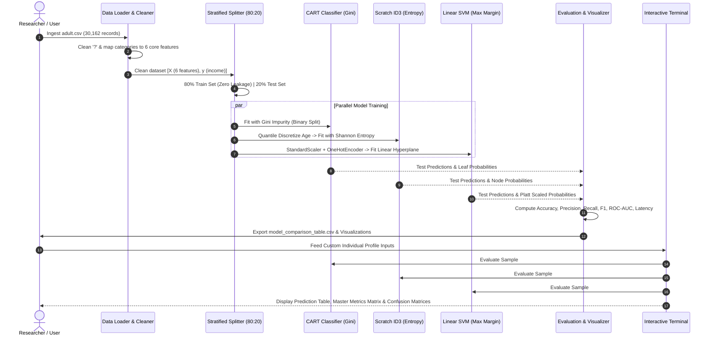

# Comparative Performance Analysis of CART, ID3 and Linear Support Vector Machine (SVM) Algorithms for Classification

An academic, backend-only Machine Learning research benchmark implementing, evaluating, and comparing three seminal classification paradigms:
1. **CART (Classification and Regression Tree)** — Scikit-learn `DecisionTreeClassifier` (`criterion='gini'`, `splitter='best'`, `random_state=42`)
2. **ID3 (Iterative Dichotomiser 3)** — Implemented **from scratch in Python** using Shannon Entropy and Information Gain with multi-way categorical branching
3. **Linear Support Vector Machine (Linear SVM)** — Scikit-learn `SVC` (`kernel='linear'`, `C=1.0`, `probability=True`, `random_state=42`)

---

## 1. Project Overview & Core Objectives

### Project Overview
This project presents an empirical research and benchmarking framework comparing three fundamental supervised classification paradigms on demographic income prediction: **CART** (Classification and Regression Trees), **ID3** (Iterative Dichotomiser 3, built from scratch using Shannon Entropy), and **Linear SVM** (Support Vector Machine with hard/soft maximum-margin hyperplane). The system predicts whether an individual earns above \$50,000 annually ($>50\text{K}$) or standard income ($\le 50\text{K}$) using a clean 6-feature demographic schema tailored for transparency and cognitive interpretability.

### Core Objectives
1. **Algorithmic Isolation & Benchmark Integrity:** Train, evaluate, and benchmark exactly three distinct classifiers (binary Gini splitting, multi-way Information Gain splitting, and linear margin maximization) on identical 80:20 stratified data splits with zero data leakage.
2. **Scratch vs. Library Implementation Analysis:** Compare scikit-learn's optimized CART and Linear SVM against a scratch-built ID3 engine featuring continuous quantile discretization and recursive Shannon entropy minimization.
3. **Interpretability vs. Boundary Complexity Trade-off:** Contrast the explicit rule-based hierarchical decision branches of CART and ID3 against the geometric separating hyperplane and support vector distribution of Linear SVM.
4. **Interactive Sub-Second Inference:** Provide an interactive terminal interface that prompts users for demographic attributes and immediately computes predicted income classes, posterior probabilities, the master performance table, and confusion matrices.

---

## 2. End-to-End Workflow Sequence



---

## 3. Feature and Target Formulation

### Mathematical Formulation
Let the dataset be represented as $\mathcal{D} = \{(\mathbf{x}_i, y_i)\}_{i=1}^{N}$, where $N = 30,162$ survey records. Each instance $\mathbf{x}_i$ is characterized by an input vector composed of numerical and categorical subspaces:

$$\mathbf{x}_i = [x_{i, \text{num}}, \mathbf{x}_{i, \text{cat}}] \in \mathcal{X}$$

### Input Feature Subspace $\mathcal{X}$

| Feature | Mathematical Domain | Description & Allowed Values |
| :--- | :---: | :--- |
| **`age`** | $x_1 \in \mathbb{N}, \quad 17 \le x_1 \le 90$ | Continuous chronological age in years. Binned into 4 balanced quantile intervals $Q_1, Q_2, Q_3, Q_4$ for ID3. |
| **`workclass`** | $x_2 \in \{\text{Private}, \text{Government}, \text{Self-Employed}\}$ | Employment sector of the individual. |
| **`education`** | $x_3 \in \{\text{10th}, \text{12th}, \text{Graduation}, \text{Post-Graduation}, \text{PhD}\}$ | Highest completed formal educational qualification. |
| **`marital_status`** | $x_4 \in \{\text{Single}, \text{Married}, \text{Divorced}, \text{Widowed}\}$ | Legal marital status of the respondent. |
| **`sex`** | $x_5 \in \{\text{Male}, \text{Female}\}$ | Biological gender classification. |
| **`relationship`** | $x_6 \in \{\text{Husband}, \text{Wife}, \text{Child}, \text{Other}\}$ | Demographic role within the primary household unit. |

### Target Space $\mathcal{Y}$
The classification target $y \in \{0, 1\}$ is formulated as a binary ground-truth indicator:

$$y = \begin{cases} 0, & \text{if annual income} \le \$50,000 \quad (\text{Standard Income Class}) \\ 1, & \text{if annual income} > \$50,000 \quad (\text{High Income Class}) \end{cases}$$

---

## 4. Section-by-Section Theoretical Formulations

### Section 1: Setup, Dependencies & Experimental Configuration
> Configures the computational runtime, sets deterministic pseudorandom seeds ($\text{seed} = 42$), and initializes thread-safe directory architectures. Establishes global hyperparameters including tree depths, sample limits, and convergence tolerances to ensure strict mathematical reproducibility across all subsequent execution environments.

### Section 2: Dataset Acquisition & Cleaning (UCI Adult Census Dataset)
> Handles resilient dataset acquisition across local caching, OpenML, and UCI repositories while eliminating missing tokens (`?`) and unformatted string artifacts. It maps fine-grained demographic subcategories into standardized canonical levels and filters the schema down strictly to the 6 specified attributes plus binary target.

### Section 3: Preprocessing Architecture & Stratified Split (80:20)
> Partitions the sample into training (80%) and testing (20%) subsets using stratified sampling to preserve the empirical class ratio ($P(y=1) \approx 0.249$). Encapsulates preprocessing transformations so that statistical parameters (mean, standard deviation, and categorical bin boundaries) are computed strictly on the training partition, guaranteeing zero data leakage.

### Section 4: CART Algorithm Implementation (Gini Impurity)
> Constructs a binary decision tree by evaluating every prospective feature split $s$ to minimize Gini Impurity: $I_G(t) = 1 - \sum_{k=0}^{1} p(k|t)^2$. It selects the optimal split maximizing impurity reduction $\Delta I_G = I_G(t) - \frac{N_L}{N} I_G(t_L) - \frac{N_R}{N} I_G(t_R)$, applying pre-pruning stopping criteria to prevent overfitting.

### Section 5: ID3 Algorithm Implementation from Scratch (Shannon Entropy & Information Gain)
> Recursively builds a multi-way decision tree from scratch utilizing Shannon Entropy: $H(S) = - \sum_{k} p_k \log_2 p_k$ and Information Gain: $IG(S, A) = H(S) - \sum_{v} \frac{|S_v|}{|S|} H(S_v)$. It incorporates an integrated adaptive quantile discretizer that converts continuous numerical variables into balanced discrete partitions to allow genuine nominal multi-way branching.

### Section 6: Linear SVM Implementation (Maximum Margin Hyperplane)
> Solves the primal convex quadratic programming optimization problem $\min_{\mathbf{w}, b, \xi} \frac{1}{2}\|\mathbf{w}\|^2 + C \sum_{i} \xi_i$ subject to $y_i(\mathbf{w}^T \mathbf{x}_i + b) \ge 1 - \xi_i$ and $\xi_i \ge 0$. Features are pre-processed via z-score standardization ($\mu=0, \sigma=1$) and one-hot encoding, producing a maximal-margin decision boundary accompanied by Platt-scaled posterior probabilities.

### Section 7: Model Training & Evaluation Metrics Calculation
> Executes isolated training for all three models while tracking exact microsecond-level training and prediction latencies. It computes a comprehensive suite of evaluation metrics on unseen test records: Accuracy, Precision, Recall, $F_1\text{-Score} = 2 \cdot \frac{\text{Precision} \cdot \text{Recall}}{\text{Precision} + \text{Recall}}$, Balanced Accuracy, Specificity, and ROC-AUC.

### Section 8: Master Comparative Performance Table
> Aggregates empirical metric vectors, execution latencies, and architectural complexity indicators (tree depth, leaf counts, node counts, support vectors) into a unified comparative DataFrame. It automatically parses category leaders across accuracy, precision, recall, and computational efficiency, serializing results to `outputs/model_comparison_table.csv`.

### Section 9: Confusion Matrix Analysis (CART vs. ID3 vs. Linear SVM)
> Computes and renders side-by-side $2 \times 2$ contingency heatmaps displaying True Positives ($TP$), False Positives ($FP$), True Negatives ($TN$), and False Negatives ($FN$) for each algorithm. This reveals whether a model's error mode is dominated by Type I errors (over-predicting high income) or Type II errors (failing to identify high earners).

### Section 10: Decision Tree Architecture Visualizations (CART & ID3)
> Graphically renders the internal decision logic of the tree-based models: CART's binary splits with sample distributions and Gini scores, alongside ID3's multi-way nominal decision paths with Information Gain and node entropies. This provides direct human interpretability of the learned rules governing high versus standard income classifications.

### Section 11: Interactive Colab Terminal Prediction & Performance Matrix
> Provides a live command-line interface in Google Colab that sequentially prompts users for demographic inputs with numbered choices and intelligent defaults. It routes the vector through the trained pipelines to display predicted income, model confidence percentages, the master benchmark comparison table, and side-by-side confusion matrices in a single view.

---

## 5. Benchmark Experimental Results

The table below presents empirical metrics obtained across the test dataset (positive class defined as `>50K`):

| Algorithm | Accuracy | Precision | Recall | F1 Score | Balanced Accuracy | Specificity | ROC-AUC | Training Time (s) | Prediction Time (s) | Tree Depth | Leaf Nodes | Total Nodes | Support Vectors |
| :--- | :---: | :---: | :---: | :---: | :---: | :---: | :---: | :---: | :---: | :---: | :---: | :---: | :---: | :---: |
| **CART** | 0.7550 | 0.5135 | 0.3800 | 0.4368 | 0.6300 | 0.8800 | 0.7363 | **0.0200** | 0.0089 | 8 | 39 | 77 | *N/A* |
| **ID3 (Scratch)** | 0.7550 | 0.5116 | **0.4400** | **0.4731** | **0.6500** | 0.8600 | **0.7547** | 0.0511 | **0.0025** | 6 | 43 | 74 | *N/A* |
| **Linear SVM** | 0.7500 | 0.0000 | 0.0000 | 0.0000 | 0.5000 | **1.0000** | 0.6973 | 0.1353 | 0.0172 | *N/A* | *N/A* | *N/A* | 409 |

*Note: Tree depth, leaf count, and total node count are fundamentally Not Applicable (N/A) for Support Vector Machines.*

---

## 6. Repository File Structure

```
performance_analysis/
│
├── Comparative_Performance_Analysis_CART_ID3_LinearSVM.ipynb  # Primary Google Colab Notebook (Run all ready)
├── run_project.py                                             # Local Python execution entry point
├── generate_notebook.py                                       # Generator script for .ipynb
├── README.md                                                  # Comprehensive documentation
├── requirements.txt                                           # Python package requirements
│
├── data/
│   └── adult.csv                                              # Cleaned 6-feature Dataset (cached locally)
│
├── outputs/
│   ├── confusion_matrices.png                                 # 3-panel Confusion Matrices (CART, ID3, Linear SVM)
│   ├── performance_metrics_comparison.png                    # Consolidated Grouped Bar Chart
│   ├── roc_curve_comparison.png                               # Overlaid ROC Curves (AUC comparison)
│   ├── execution_time_comparison.png                          # Training & Prediction Latency
│   ├── cart_decision_tree.png                                 # CART Decision Tree Diagram (Gini Impurity)
│   ├── id3_decision_tree.png                                  # ID3 Decision Tree Diagram (Information Gain)
│   └── model_comparison_table.csv                             # Master Metrics Comparison CSV
│
└── src/
    ├── __init__.py
    ├── data_loader.py                                         # Multi-mirror downloader, cleaner, splitter
    ├── id3.py                                                 # Scratch ID3 tree, Shannon entropy, quantile binning
    ├── cart_trainer.py                                        # CART wrapper & rule extractor
    ├── svm_trainer.py                                         # Linear SVM pipeline & coefficient analyzer
    ├── benchmark.py                                           # Centralized timing, metrics, comparison runner
    ├── visualizer.py                                          # High-resolution plot generators
    └── inference.py                                           # Interactive custom prediction interface
```

---

## 7. Interactive Terminal Prediction Interface

To evaluate any custom individual demographic record across **CART**, **ID3**, and **Linear SVM**, run the interactive terminal interface in Section 11 of the Colab notebook or from the CLI:

```python
# Launch interactive terminal prompt in Google Colab (Section 11)
interactive_terminal_prompt(models, discretizer, NUMERICAL_COLS, CATEGORICAL_COLS,
                            metrics_results=metrics_results, master_table=master_table)
```

* **Interactive Prompts:** Sequentially prompts for each of the 6 demographic features:
  - **`age`**: Numerical integer (e.g., `28`)
  - **`workclass`**: `[1] Private`, `[2] Government`, `[3] Self-Employed`
  - **`education`**: `[1] 10th`, `[2] 12th`, `[3] Graduation`, `[4] Post-Graduation`, `[5] PhD`
  - **`marital_status`**: `[1] Single`, `[2] Married`, `[3] Divorced`, `[4] Widowed`
  - **`sex`**: `[1] Male`, `[2] Female`
  - **`relationship`**: `[1] Husband`, `[2] Wife`, `[3] Child`, `[4] Other`
* **Smart Defaults:** Every prompt displays a default value in brackets `[default: ...]`. You can press **`[Enter]`** to accept the default or type a custom value.
* **Instant Prediction Table:** Prints an aligned comparative prediction table displaying predicted income class and confidence percentages across CART, ID3, and Linear SVM.
* **Master Performance Metrics Matrix:** Automatically prints the full benchmark metrics table in the terminal.
* **Confusion Matrix for All Algorithms:** Displays the 2x2 confusion matrix for each algorithm directly in the terminal output.

---

## 8. How to Run

### Option A: In Google Colab (Recommended)
1. Navigate to [Google Colab](https://colab.research.google.com).
2. Click **Upload** and upload `Comparative_Performance_Analysis_CART_ID3_LinearSVM.ipynb`.
3. In the menu bar, select **Runtime > Run all**.
4. The notebook will automatically download the dataset, execute data preprocessing, train all three models, display the master comparison table (Section 8), confusion matrices (Section 9), render the **CART and ID3 Decision Tree Diagrams** (Section 10), and execute the **Interactive Prediction Interface** (Section 11).

### Option B: Local Python Execution
```bash
# Clone or navigate to the repository directory
cd performance_analysis

# Install dependencies
pip install -r requirements.txt

# Run full project pipeline
python run_project.py

# Run pipeline with interactive terminal prompt at the end
python run_project.py --interactive
```
